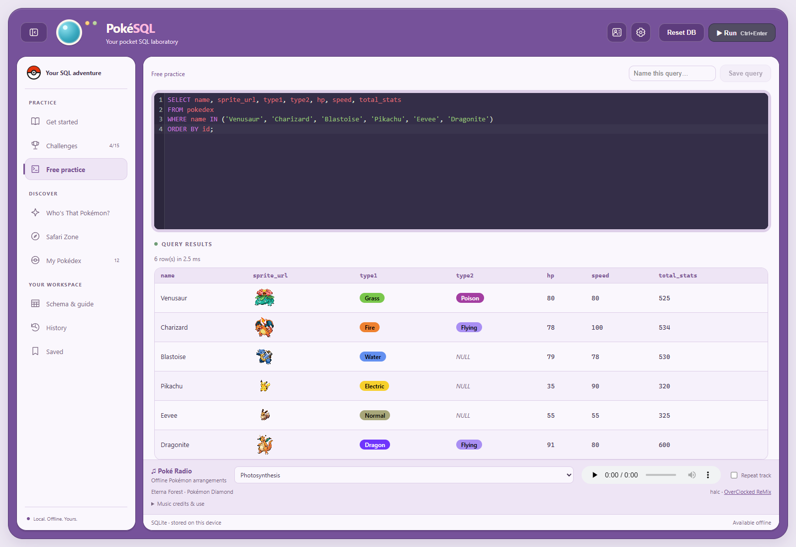

# PokéSQL 🔴⚪

Practice real SQL with 1,025 Pokémon from Generations I–IX. Explore types,
stats, evolutions, Mega and regional forms, abilities, and the type-effectiveness chart in a web app
or a Windows desktop application. No account, cloud database, or backend.

Browse the [current screenshot gallery](docs/screenshots/README.md) for the
practice pages, all eight Poké Ball themes, Safari exploration/catches, Trainer ID,
Pokédex and iPad-sized layouts.

Designed primarily for desktop/laptop browsers and iPads in portrait or landscape.
Touch screens get larger editor text and controls. A narrow-screen fallback is
available, but phones are not the main SQL-writing experience.



## Start the web app

Use Node.js 22.12 or newer (Node 24 recommended).

```powershell
cd web
npm install
npm run dev
```

Open http://localhost:5173. If PowerShell blocks `npm.ps1`, use `npm.cmd`
in place of `npm` in these commands.

## Windows application

Download the small `PokeSQL-<version>-setup.exe` from
[GitHub Releases](https://github.com/jaguan2/poke-sql/releases). It installs the
full application for your Windows user and creates a shortcut. First setup needs
internet access, or the matching `.nsis.7z` payload beside the installer. Once
installed, open the application from its shortcut; it works offline.

Installed builds check for stable releases in the background. A verified update
installs when you close PokéSQL normally, without restarting it or interrupting a
query. Failed/offline update checks leave the current version usable. SQL drafts,
saved queries, database edits, Pokédex and Safari progress remain in the existing
Windows user profile. Existing portable users can run the installer once to opt
into updates; portable builds continue to use manual replacement.

For development and local builds:

```powershell
cd web
npm install
npm run desktop          # build and open the desktop app
npm run desktop:build    # build web installer + payload + offline portable EXE
```

The Windows x64 build produces:

- `web/release/nsis-web/PokeSQL-0.2.0-setup.exe` — small web installer.
- `web/release/nsis-web/poke-sql-web-0.2.0-x64.nsis.7z` — full application payload.
- `web/release/nsis-web/latest.yml` — version and checksums for the updater.
- `web/release/PokeSQL-0.2.0-portable.exe` — full application for offline first launch.

The full application uses Electron and includes the database, SQLite engine,
music and all sprites. The portable build works offline from its first launch. Building requires
internet access to download npm dependencies and Windows packaging tools;
the finished app does not. Builds are unsigned; no signing certificate is
configured. The portable EXE still saves its workspace in the Windows user
profile, so moving the EXE does not move your saved work.

Generated EXEs and installer payloads are ignored by Git. The repository-root
`PokeSQL.exe`, when copied there for convenience, is the small installer; keep
its matching payload beside it for local setup before that release is published.
Builds are distributed as release downloads instead of committed binaries.
See [releasing and testing updates](docs/RELEASING.md).

## Practice tools

- **Safari Zone:** explore nine habitats: Verdant Forest, Willow Wetlands,
  Amber Ridge, Sunlit Meadow, Azure Coast, Mirage Dunes, Moonstone Caverns,
  Frostveil Tundra, and Ember Foothills. Use **Choose from 9 habitats** to travel.
  Move the trainer with arrow keys/WASD while exploring, or swipe the map on a
  touchscreen. A brief controls popup appears when you first explore.
  **Trainer-card icon → Your trainer model** offers eight models: Red, Leaf, Brendan and
  May in Emerald and Ruby/Sapphire outfits, Wally, and Steven. Each has matching
  portraits, walking and battle sprites. Your choice saves on this device and also appears
  in daily/random mystery encounters. Keyboard walking works after clicking
  around the Safari; typing, Profiles, Settings and the habitat picker pause it.
  All areas stay open, with a featured area rotating
  daily at 00:00 UTC. Each has its own layout and habitat-appropriate species.
  Routes now scroll with the trainer through winding trails, tree clusters,
  ledges, bridges, ponds, flower borders and beach landmarks. Open **Route map**
  for an overview showing you, the trailhead and the next shaking patch.
  Location and weather follow the [Wild Area's design](https://swordshield.pokemon.com/en-us/gameplay/wild-area/):
  daily local conditions favor certain encounters. Marked species have twice
  their usual encounter weight; no species is weather-locked.
  The **Encounter table** shows the actual next-roll chances, including weather
  and the last caught species being skipped until you catch something different. Walking encounters draw
  from that same weighted table.
  **Special events** lists active and upcoming Legendary and Mythical visitors,
  their habitats, UTC start/end times, and exact encounter odds. A rotating
  Legendary visits Friday–Sunday with a **1%** chance per encounter in its
  habitat. A rotating Mythical visits on days **1–7 of each month** with a
  **0.25%** chance. These visitors enter the encounter table during their event
  window. Weather and shaking patches preserve their advertised odds. An
  encounter already in progress can still be caught after the event ends,
  including after an offline reload. Daily mystery date assignments continue
  using their published schedule.
  Walk through tall grass, sand, snow, or cave patches for a chance encounter, or investigate the sparkling,
  shaking patch for a guaranteed encounter; it moves to fresh grass after each
  successful catch. Grass kicks up around your trainer before a split-screen
  wipe and opposing trainer/Pokémon slide-ins reveal a short SQL catch assignment.
  Encounter and catch screens preserve the Game Boy Advance's **240×160 (3:2)**
  proportions. Encounters fill Safari's available width, with the SQL notebook
  or caught Pokémon's entry beside the battle on wide screens; narrower screens
  stack both panels at full width. The layout also responds to the navigation
  rail being expanded or collapsed. The frame follows
  [Nintendo's GBA display specifications](https://www.nintendo.com/en-gb/Support/Legacy-system/Technical-data-619479.html).
  The field guide marks registered species and tracks each habitat's collection.
  A small Poké Ball beside a Pokémon's name means it's already in your Pokédex.
  Saved encounters resume without replaying their entrance. Assignments progress
  through filtering, selecting stats, joining types, and surveying abilities,
  then cycle. Correct results register a catch in your Pokédex and achievements.
  Your trainer winds up and pitches your selected theme's ball toward the Pokémon,
  using the game's throwing poses. It captures the Pokémon in a flash,
  then lands and shakes before the Pokédex entry appears. Reduced motion skips
  the sequence. Reloading during the throw preserves the catch without replaying it.
  The entry reveals the caught Pokémon's sprite, category,
  types, height, weight, generation, and English game description. Keep exploring
  or open your collection afterward. Entries remain available offline and after
  reloading a caught encounter, including older saves.
  Incorrect queries and leaving an encounter add nothing. Settings → Safari
  encounters offers **unlimited attempts** (the default), **5 incorrect answers**,
  or **8 incorrect answers** before a Pokémon flees. Remaining chances and warning
  dialogue make the limit clear. Hints, SQL errors, stopped queries and timeouts
  keep your chances; a correct answer on the final chance still catches.
  Changes apply to the next encounter. Fled encounters offer a solution review,
  stay fled after reload, and remain available in the encounter pool. There is
  no daily catch limit. Your expedition, current encounter, and draft save locally without
  executing SQL on reload. Safari works offline, supports reduced motion, and
  always grades against the original database.

  Map tiles and grass/dust effects use archived
  [Pokémon Emerald assets](https://github.com/pret/pokeemerald/tree/9103e529c2fbdd7add4a1ff3350c6c1f92112c42/data/tilesets).
  Red's walking/back sprites, battle platforms, window frames and pixel lettering
  use [FireRed/LeafGreen assets](https://github.com/pret/pokefirered/tree/ce6406d8c2eaf46d543c8a2606de0c3cb1951982/graphics).
  Grass encounters pair native platforms with a warm striped backdrop; a light
  dialogue window and compact Dex/status plate follow the supplied game references.
  Pokémon keep their native proportions, with transparent margins removed at display time
  so their feet sit on the platform. The plate shows the name, a random level
  from 5–50, and catch status. Levels stay fixed for an encounter through guesses
  and reloads; they are cosmetic and leave SQL grading unchanged.
  Route sections use Emerald's original layouts and metatiles, adapted to the
  Safari walking game. Existing clearing saves retain their catches, active
  assignments and SQL drafts; the trainer moves to the new route's trailhead.
  Credits and source paths are in
  `web/public/safari/CREDITS.txt`. To regenerate the bundled artwork, install
  `pillow` and `fonttools[woff]`
  and run `py scripts/build_safari_assets.py` from the repository root. Builds
  check map/collision pairs, asset hashes and sprite geometry; runtime needs no Python or downloads.

- **Mobile workspace:** one page scroll with Run and Stop in a sticky header.
  **Tools & schema** expands the query browser, which folds away after a choice.
  Mystery guesses become cards with all five clues visible; wide SQL results
  retain horizontal scrolling. Long SQL scripts scroll inside the editor.
- **SQL guide:** an expandable SQLite reference below the schema browser, from
  SELECT and filtering through joins, grouping, NULLs, CTEs, and window functions.
  **Load example** fills the current editor without running SQL or checking an
  answer. Open **Schema & guide** from the sidebar to browse the reference.
- **My Pokédex:** a personal collection of Pokémon found by solving daily and
  random mysteries or completing Safari catch assignments. Each species has one entry with its sprite, types, generation,
  height, weight, first registration date (UTC), best guess count, and discovery
  modes. Search by name or Dex number, filter by generation, or sort your finds.
  The collection saves separately from the practice database and survives new
  rounds, offline reloads, and Reset DB. Currently saved solved rounds are imported
  automatically; their registration date is when they enter the collection.
  Safari's latest saved catch is imported idempotently using its catch timestamp.
  If a collection entry is malformed, valid entries are recovered and the raw
  save is backed up before replacement. If that backup cannot be saved, the
  original collection is retained and recovery stays session-only.
- **Achievements:** open **My Pokédex → Achievements** for overall, generation,
  and type collections, such as **12 / 151 Gen 1** or **5 / 81 Fire types**.
  Generation milestones unlock at 10, 25, 50, 100, and full completion; type
  milestones start at 5. Goals beyond a collection's size are omitted. Counts
  use unique discovered species, with dual types progressing both collections.
  Existing discoveries count automatically, and progress works offline. Goal
  totals come from the original bundled database, independent of practice edits.
- **Who’s That Pokémon?** A daily hidden species and a SQL guessing notebook.
  A Safari-style 3:2 battle scene shows the trainer facing the Pokémon's full-color
  sprite. A random level from 5–50 appears beside its hidden name, shown as `???`.
  A correct SQL guess reveals the name. Daily and random rounds both use
  this encounter view, and their levels persist with saved progress.
  Everyone using the same app version gets the same Pokémon for a UTC date;
  the next challenge becomes available at **00:00 UTC**. The fixed shuffled
  schedule visits all 1,025 species before repeating, so no calendar year has
  duplicate answers and the same date changes the following year. An open
  round stays on its date after midnight; **Open today's challenge** switches
  to the new puzzle. Daily challenges cannot be rerolled.
  Return one row with an `id` or `name` column to make a guess. Green tiles
  mean exact traits; yellow means a type matches the other slot; arrows point
  toward the hidden Pokémon's generation, height, or weight. Queries with
  multiple rows or no identifiable Pokémon remain research and do not use guesses.
  Matching every trait does not guarantee the same species: identify the exact
  Pokémon to win. There is no guess limit; the latest 30 guesses, total count,
  current target, and SQL draft save locally without replay on reload.
  Queries use fresh read-only copies of the original database, keeping practice
  edits separate. **Random practice** keeps its own round and draft;
  **New Pokémon** starts another random round. Both modes work offline, using
  the device's UTC clock for the daily schedule. Only the latest opened daily
  round is retained; past-day puzzle archives are not included.
- **Poké Radio:** three bundled Pokémon arrangements from OverClocked ReMix,
  with playback, volume, track selection, and repeat controls below the results.
  Tracks advance in playlist order and return to the first track. Selecting a
  track pauses playback. Track choice, volume, mute, and repeat save locally;
  reopening the app always starts paused. Music works offline after the web
  app finishes caching, and immediately in desktop builds.
- **Trainer ID:** use the trainer-card icon in the header to name your trainer,
  choose among eight character models, and see your Pokédex entries, Safari
  catches, completed SQL challenges and discovered types on a game-inspired card.
  Its five-digit local ID and issue date stay the same when you rename your
  trainer or change models. Eight SQL badges mark challenge-completion milestones.
  Boy/girl style filters help browse models. Existing choices and collections carry over.
- **Settings:** use the gear icon to choose Poké,
  Great, Ultra, Master, Heal, Dive, Dusk, or Luxury Ball colors. Your choice
  saves on this device and works offline. Ultra, Dusk, and Luxury offer dark
  panels; the other themes keep the softer light panels.
- **SQL autocomplete:** enable or disable suggestions in Settings. When enabled,
  the editor suggests table and column names, SQL keywords, and phrases such as
  `LEFT JOIN`, `GROUP BY`, and `ORDER BY`. Use the arrow keys and Enter to accept
  a suggestion, Escape to dismiss, or Ctrl+Space to open the list. The setting
  saves on this device; accepting a suggestion does not execute SQL.
- **SQL editor:** SQLite syntax highlighting, schema autocomplete,
  Ctrl+Enter / Cmd+Enter, and multiple statements.
- **Workspace menu:** sectioned, icon-led navigation opens dedicated pages for
  practice, discoveries and your saved work. The panel button beside the logo
  collapses desktop navigation to a compact icon rail and hides it on phones.
  The choice saves on this device; your SQL draft and current results stay intact.
- **Get started:** a browsable page of 25 specific prompts, including Charizard's Pokédex card,
  Pikachu and Eevee, a Kanto starter comparison, Eevee's evolutions, and
  Dragonite's family tree, alongside broader Pokédex queries. Each has a SQL hint and
  worked answers, with alternative approaches for many problems. New examples
  cover Mega counts, regional variants, evolution stages, capture rates, and
  Charizard's default and Mega stats. Topic tiles, search, difficulty labels and
  saved-draft filters help you pick a question. Selecting a prompt, revealing
  an answer, or loading it into the editor never runs SQL automatically.
- **Challenges:** a dedicated page of fifteen exercises with topic/search filters,
  difficulty labels, hints, result checking and saved completion progress. Filter
  by completed exercises or saved drafts. Answers use a fresh copy of the original Pokédex.
  Reveal **Hint** for a SQL fragment or **Answer** for worked solutions.
  **Use this answer** loads the chosen approach; only **Check answer** grades it.
  New Pokémon-focused tasks include Charizard's profile and dual-type weaknesses,
  Pikachu's speed club, Lucario's full ability list, Kanto's Mega roster,
  baby evolution stages, and Mega Charizard's changing types.
- **Saved work:** separate editor drafts for free practice and each challenge,
  named queries, and the last 30 distinct query runs. History and Saved open
  their own pages. Schema & guide combines the database browser and SQL reference;
  examples return to the editor you were using, including an active Safari catch.
- **Database saves:** completed changes persist locally in IndexedDB. Reset DB
  restores and saves the original database, keeping your SQL and progress.
  Older saved databases stay intact after an app update. A notice offers
  **Reset DB and load update** to load new fields and forms; this explicitly
  replaces practice database edits while keeping drafts, saved queries,
  challenge progress, and your personal Pokédex. Challenges and mysteries
  always use the latest bundled original data.
- **Responsive execution:** SQL runs in a Web Worker. Stop interrupts a query;
  an eight-second timeout also catches expensive queries. Recovery restores the
  last completed snapshot, discarding unsaved changes from the interrupted run.
- **Results:** Pokémon sprites, type badges, explicit NULLs, and empty-result
  column headers. Up to 2,000 rows are fetched per statement, with pagination
  displaying 500 at a time.

SQL transactions work across runs. An open transaction is not saved until
COMMIT. Temporary objects and attached databases stay in the live session;
automatic saves pause until you drop the temporary objects and detach the
databases. Notices explain when saving is paused or unavailable.

Autosave preserves supported connection PRAGMAs, but sql.js reopens the
connection when exporting a snapshot. Read `last_insert_rowid()`, `changes()`,
or `total_changes()` in the same SQL script as the modifications they describe;
these connection counters reset between saved runs.

Work is local to the current browser profile and site address (or desktop
profile); web and desktop saves are separate. Clearing site data removes
saved work. Use one tab per workspace: simultaneous tabs do not merge edits.

## Production web build and offline access

```powershell
cd web
npm run build
npm run preview
```

Deploy the contents of `web/dist/` to a static HTTPS host. Relative asset
paths support deployment in a subdirectory. Opening `index.html` directly
with `file://` is not supported; use the preview server or desktop EXE.

On the first online visit, the production app caches its complete bundle,
database, and all sprites. Wait for **Available offline** before disconnecting.
Offline caching needs HTTPS or localhost and sufficient browser storage;
development mode does not install a service worker. When an update is ready,
close all PokéSQL tabs and reopen the site.

## Data and assets

Safari offers 72 regular species plus nine Legendary and six Mythical event
visitors across nine habitats (87 distinct species and 90 habitat slots,
including species shared by habitats). Route graphics and field effects come
from the [Pokémon Emerald archive](https://github.com/pret/pokeemerald); Red's trainer
sprites, battle graphics and lettering come from the
[FireRed/LeafGreen archive](https://github.com/pret/pokefirered).
Trainer PNGs are unchanged, with native transparency. Battle palettes and frames
are adapted for the Safari and mystery encounter interfaces. See the
[Safari asset credits](web/public/safari/CREDITS.txt). Assets ship locally and
their hashes are checked by the build.

`pokemon` and the beginner-friendly `pokedex` view still contain exactly one
row per species (1,025). Both expose `has_mega_evolution`, `mega_form_count`,
`has_regional_form`, `evolution_stage`, and `can_evolve`. The view also exposes
`capture_rate`, `color`, `habitat`, `is_baby`, `genus`, `base_happiness`,
`base_experience`, and `evolves_from_id` alongside its original columns.

`pokemon_forms` holds 1,579 linked form records with names, stats, dimensions,
Mega/regional flags, and introduction information. Join its `species_id` to
`pokemon.id`; form IDs and `source_pokemon_id` identify different source records.
Use `pokemon_form_types` and `pokemon_form_abilities` for form-specific joins.
`pokemon.generation_id` means species debut; `introduced_generation_id` and
`introduced_version_group` describe the form's introduction. Stats and abilities
are inherited from the source Pokémon variety; types include source form overrides.
Only the 18 canonical types are linked; the historical unknown Arceus form has
no canonical type link. Species sprites remain the bundled default sprites.

Evolution stages start at 1 and include baby species. `can_evolve` follows
species links, including regional-only branches; it does not promise that every
form can evolve in every game. Mega transformations do not add an evolution
stage. Regional flags include named Alolan, Galarian, Hisuian, and Paldean forms,
excluding region-themed costumes such as Pikachu's Alola cap. `capture_rate`
is a catch-rate parameter, not a percentage. Missing habitats remain NULL.
Form metadata comes from [PokéAPI's form data](https://pokeapi.co/docs/v2/#pokemon-forms).

Poké Radio bundles unchanged MP3 arrangements by halc, Emunator, and NoTuX
(formerly Blue Magic), from [OverClocked ReMix](https://ocremix.org).
The recordings are used under its [noncommercial content policy](https://ocremix.org/info/Content_Policy),
which requires attribution and forbids changing redistributed MP3s, including
their tags. See [music credits and distribution conditions](web/public/music/CREDITS.txt).
The three tracks add approximately 17.7 MB to the download and offline cache.
Their hashes are checked during every production build. Music rights are
separate from the code; reassess them before commercialization or fundraising.

Pokémon sprites come from the [PokeAPI sprites collection](https://github.com/PokeAPI/sprites).
The theme picker's eight ball icons also come from that repository's
[`sprites/items/` folder](https://github.com/PokeAPI/sprites/tree/master/sprites/items)
and are bundled locally. Theme palettes are our interpretations of the ball
designs shown in the [official Pokémon Trainer Guide](https://diamondpearl.pokemon.com/en-us/trainersguide/fundamentals/battling/).
We bundle the default front-facing PNGs from its
[`sprites/pokemon/` folder](https://github.com/PokeAPI/sprites/tree/master/sprites/pokemon),
one per species, in `web/public/sprites/`. Both the web and desktop apps load
these local copies, including offline; they do not fetch images from PokéAPI
at runtime.

The upstream collection also offers back, female, and shiny variants,
Dream World SVGs, official artwork PNGs, and animated Showdown GIFs. Those
additional sets are not bundled in PokéSQL. The Showdown battle animations
are credited upstream to the [Smogon community](https://www.smogon.com/).

The SQLite database and 1,025 local sprites ship with the repository. Python
is only required to rebuild the dataset:

```powershell
py scripts/build_db.py --refresh
py scripts/build_pokedex_entries.py --refresh
cd web
npm run sprites          # download any missing sprites for the rebuilt DB
```

The sprite downloader validates PNG headers, retries failures, and uses atomic
file replacement. `npm run sprites -- --refresh` re-downloads existing sprites.
Every production build verifies that all database species have a local sprite.
It also verifies the bundled Pokédex descriptions cover every species and match
the database's categories. `scripts/build_pokedex_entries.py` reads the existing
database without modifying it, uses cached PokéAPI species flavor text and version
names, chooses the English entry with the highest available version ID, and
normalizes the game's line and page breaks. Game versions are shown on each entry.

## Code organization

The frontend separates app composition (`web/src/app/`), feature-owned models,
components and styles (`web/src/features/`), and reusable SQL, storage, Pokémon
and UI code (`web/src/shared/`). Engine, browser and desktop tests have separate
directories. The build checks dependency boundaries and runtime import cycles.

See the [architecture guide](docs/ARCHITECTURE.md) for ownership rules and how to
add a feature, and the [test guide](web/tests/README.md) for focused checks.

## Verification

```powershell
cd web
npm run build
npm test                 # builds fresh, then database + Chrome browser tests
npm run test:desktop     # hidden Electron smoke test
```

Browser tests use an installed Google Chrome. The suite checks persistence,
reset, isolated grading, explicit transactions, temporary tables, cancellation,
timeouts, offline reload, sprites, unusual table names, and responsive layout.
To test a packaged build, set `POKESQL_EXECUTABLE` to the absolute path of
`web/release/win-unpacked/PokeSQL.exe` before running `npm run test:desktop`.

## Agent skills

Project-local engineering, strict structural review and verification skills
are available for explicit use. See [the skill guide](docs/AGENT_SKILLS.md)
for names, example prompts, sources and verification recipes.

See [CLAUDE.md](CLAUDE.md) for development guidance and [NOTES.md](NOTES.md)
for architecture decisions and remaining ideas.

Data from [PokeAPI](https://pokeapi.co/), its
[CSV dumps](https://github.com/PokeAPI/pokeapi/tree/master/data/v2/csv), and
[sprites repository](https://github.com/PokeAPI/sprites).
Pokémon and Pokémon character names are trademarks of Nintendo. This is an
unofficial educational fan project, not affiliated with or endorsed by
Nintendo, Game Freak, or Creatures.
