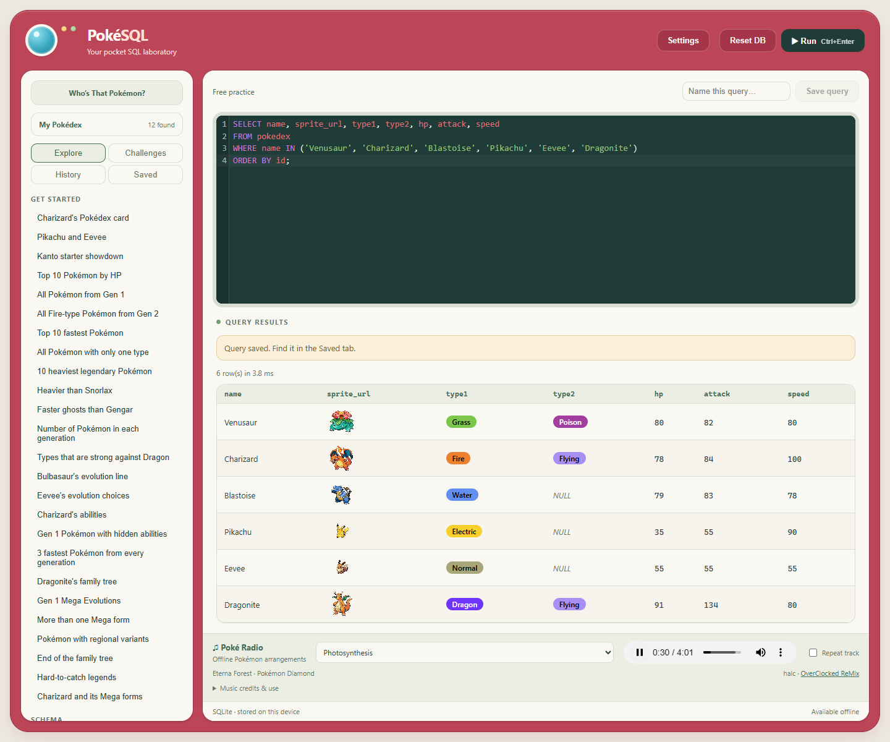
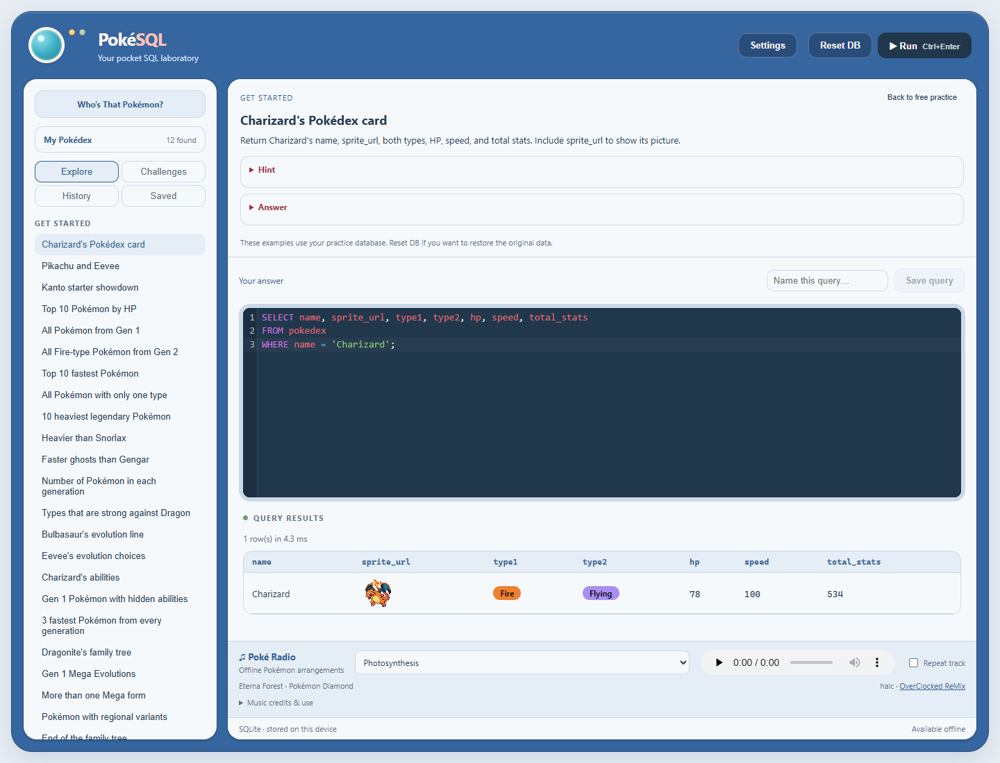
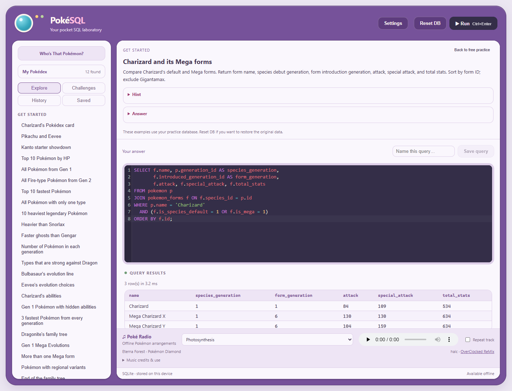
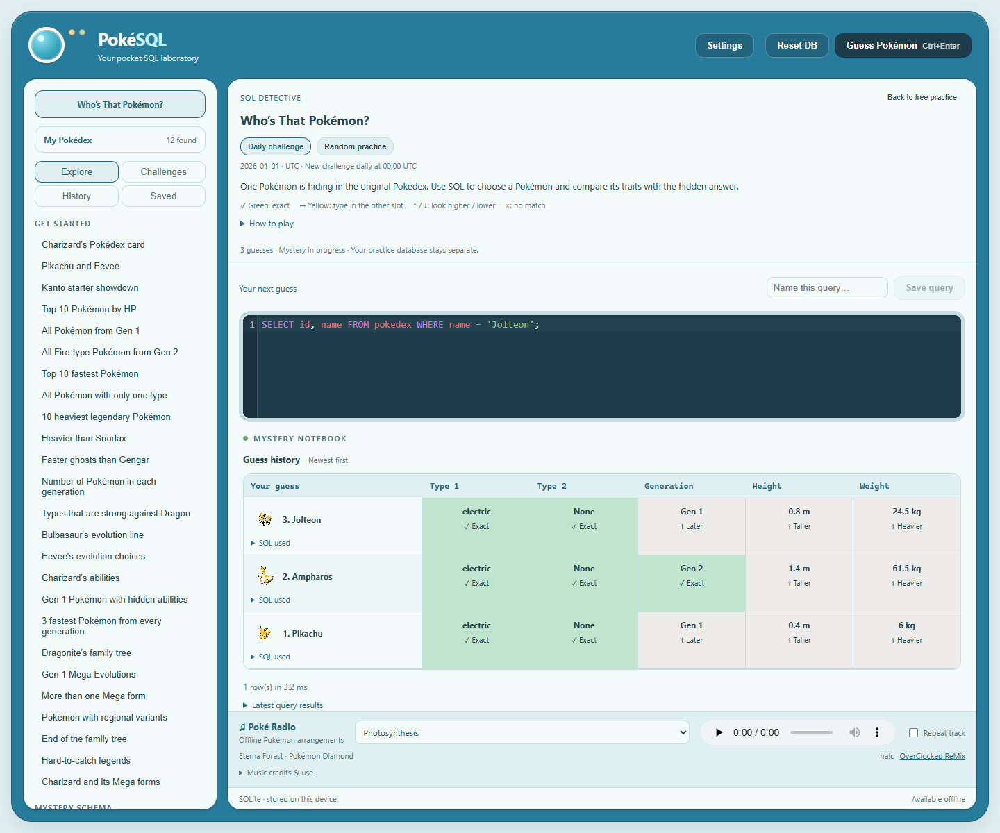
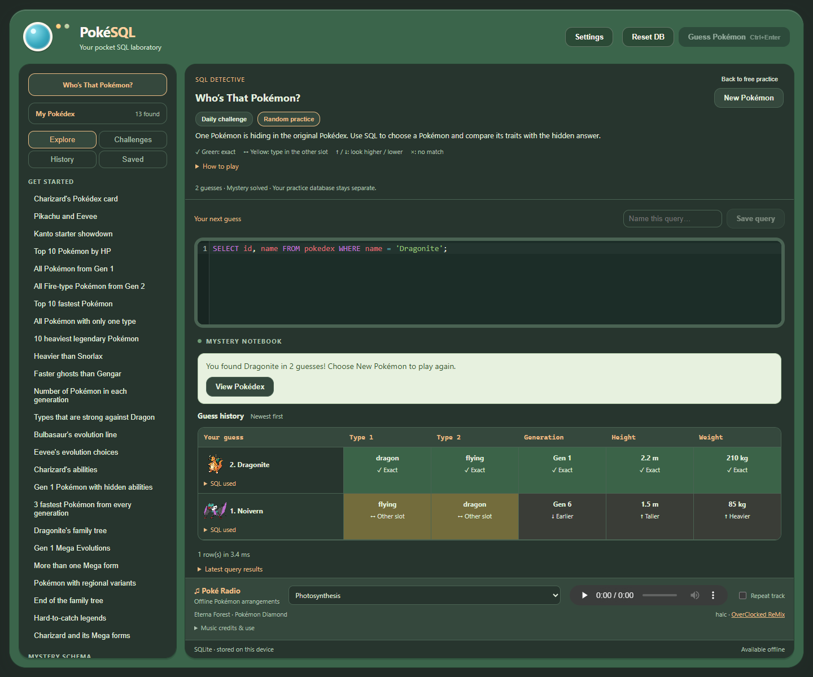
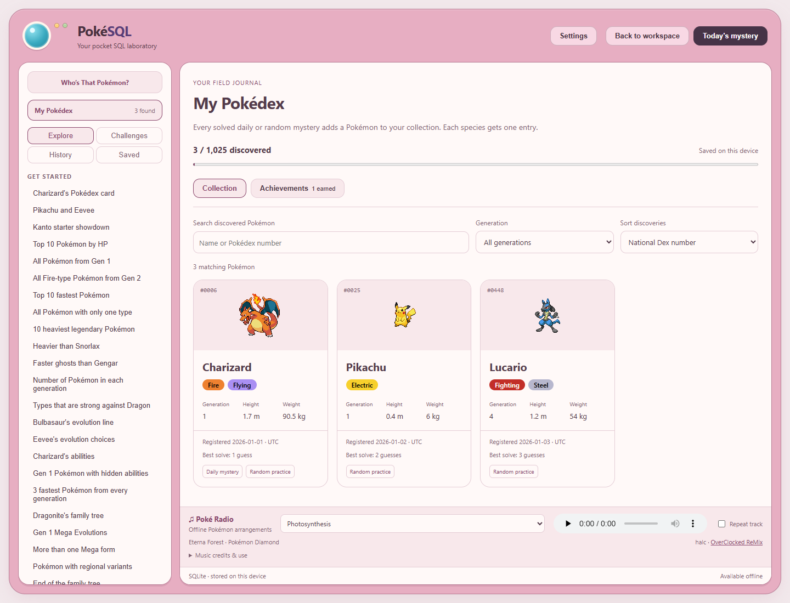
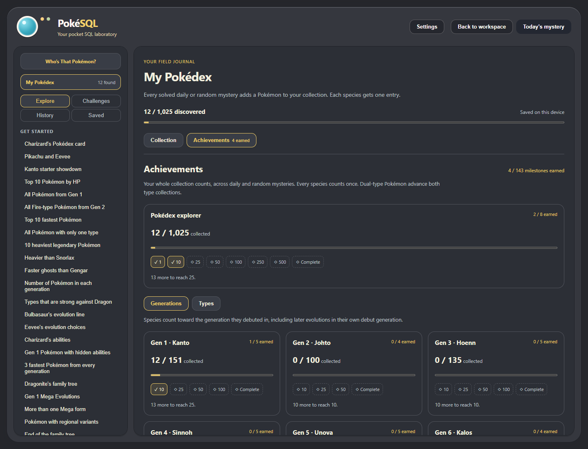
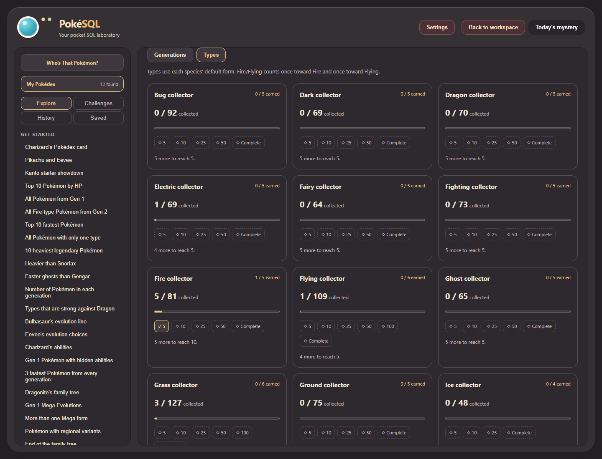
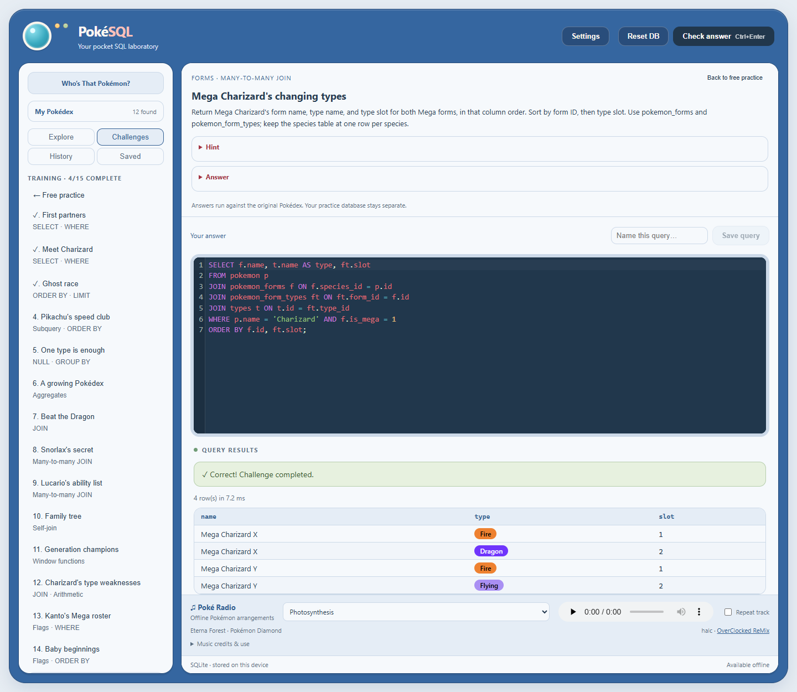
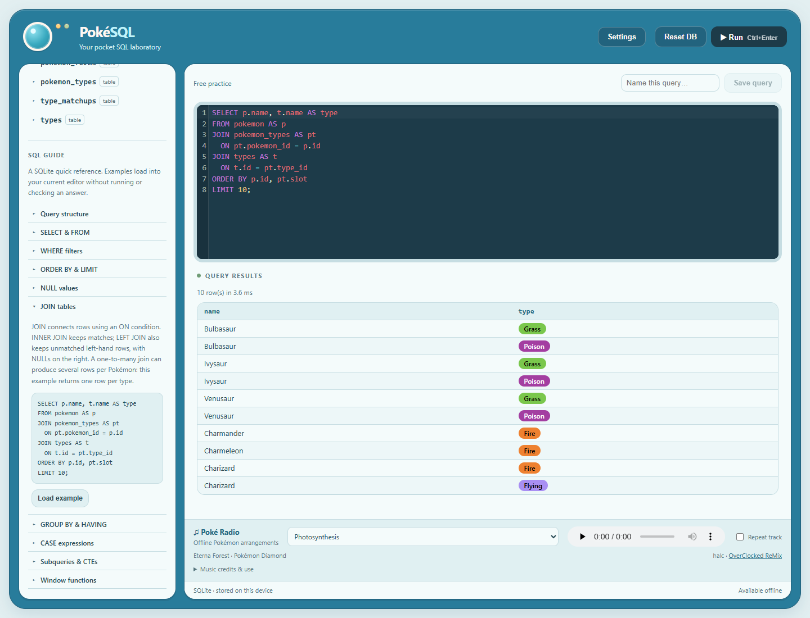

# PokéSQL screenshots

Updated November 18, 2026, from the production web app in isolated Chrome
profiles. All ten photos show the desktop interface, using all eight ball themes.
These are actual application screenshots: SQL examples and guesses ran through
the worker. Collection previews use demo saves with canonical Pokémon traits;
no personal workspace was used.

The daily puzzle is dated January 1, 2026, so the photos do not reveal today's
answer. The solved random round uses a demonstration target of Dragonite.

| Photo | Theme | Viewport |
| --- | --- | --- |
| SQL practice and Poké Radio | Poké Ball | 1440 × 1200 |
| Charizard's Pokédex card | Great Ball | 1440 × 1100 |
| Charizard and its Mega forms | Master Ball | 1440 × 1100 |
| Daily mystery | Dive Ball | 1440 × 1200 |
| Solved random mystery | Dusk Ball | 1440 × 1200 |
| Personal Pokédex | Heal Ball | 1440 × 1100 |
| Generation achievements | Ultra Ball | 1440 × 1100 |
| Type achievements | Luxury Ball | 1440 × 1100 |
| Mega Charizard SQL challenge | Great Ball | 1440 × 1250 |
| SQL guide | Dive Ball | 1440 × 1100 |

## SQL practice and Poké Radio

A saved Kanto team query with six species, bundled sprites, type badges, and
stats. Poké Radio is playing bundled music. Poké Ball theme.

## Popular Pokémon problems

Charizard's Pokédex card introduces exact-name filtering and shows its sprite,
types, and stats. The catalog contains 25 starting prompts and 15 graded
challenges. Great Ball theme.

Charizard's default and Mega forms demonstrate a species-to-forms JOIN, with
separate species and form introduction generations and different battle stats.
Master Ball theme.

## Daily mystery

Three submitted SQL guesses narrow down a historical daily Pokémon using exact
matches and higher/lower clues. Dive Ball theme.

## Solved random mystery

A completed random round shows yellow type-slot clues for Noivern and the final
all-green Dragonite guess. Dusk Ball theme.

## Personal Pokédex

Charizard, Pikachu, and Lucario appear with sprites, types, generation, physical
traits, first registration, best solve, and discovery mode. Heal Ball theme.

## Collection achievements

The demo collection contains 12 Gen 1 species and five unique Fire types.
Generation tracks show completion goals, earned milestones, and the next target.
Ultra Ball theme.

The type view is scrolled to the category controls and Fire milestone, showing
the earned five-species badge and progress toward ten. Luxury Ball theme.

## SQL challenge

Mega Charizard's changing types is completed with joins through species, forms,
form types, and types. The four returned rows show Fire/Dragon for Mega Charizard
X and Fire/Flying for Mega Charizard Y. Great Ball theme.

## SQL guide

The expanded JOIN reference below the schema sits alongside its executed
example, which returns one row per Pokémon type. Dive Ball theme.

## Mobile verification

Mobile screenshots are kept with test evidence under `web/test-results/`, outside
this desktop gallery. The refresh checks include widths of 320, 390, and 620 px,
plus an intermediate 680 px view: single page scrolling, labeled mystery clues,
horizontal scrolling for wide SQL tables, collection and achievement cards,
schema tools, guide examples, music controls, theme settings, and Run/Stop access.
