# PokéSQL screenshot gallery

Fresh application photos captured November 19, 2026, from the production build
in isolated Chrome contexts. These replace the older galleries and videos.
The primary gallery targets desktop browsers and iPads. Tablet images use touch
emulation at portrait/landscape sizes; they are not captures from physical iPad hardware.
These captures include the compact page gutters, aligned navigation and revised
schema picker with its adjacent column reference.
The workspace, mystery and SQL encounter photos now show the editor footer with
Undo/Redo and Run controls, without the query naming and saving form.

The Kanto photos show the first connected journey from Pallet Town to
Cerulean City, including the schematic region map and native Viridian Forest.
Tablet Kanto photos keep the menu collapsed to give the map room.
Kanto walkthroughs start with a fresh exploration save and the demo PC entries.
Hoenn photos show Littleroot Town, the first journey's 14-location overview
and Petalburg Woods. Hoenn tablet photos show the region map with the menu collapsed.
Johto photos show the first 17-location journey, native New Bark Town and Ilex
Forest. The area dropdown permits direct travel to any included map in all
three regions. Johto tablet photos show this control with the menu collapsed.

The demonstration profile has 12 Pokédex entries, 12 Safari catches and four
completed challenges. The Lapras catch runs a correct SQL statement and raises
the catch counter to 13. These are demo saves, not a live user's progress.
The daily mystery uses January 1, 2026, so the gallery does not reveal today's puzzle.
PC photos include the twelve imported species plus the new level-37 Lapras
capture as a separate individual. The profile photo features that Lapras and
five imported Pokémon; unknown historical levels remain marked as imported.

| View | Theme | Viewport |
| --- | --- | --- |
| [Get started](get-started.png) | Poké Ball | 1600 × 1100 |
| [Challenges](challenges.png) | Great Ball | 1600 × 1100 |
| [SQL workspace](sql-workspace.png) | Master Ball | 1600 × 1100 |
| [Pallet Town](kanto-pallet-town.png) | Poké Ball | 1600 × 1100 |
| [Kanto region map](kanto-region-map.png) | Poké Ball | 1600 × 1100 |
| [Viridian Forest](kanto-viridian-forest.png) | Dusk Ball | 1600 × 1100 |
| [Kanto area music](kanto-area-music.png) | Dusk Ball | 1600 × 1100 |
| [Portrait tablet Kanto](tablet-kanto-820.png) | Dive Ball | 820 × 1180, touch |
| [Landscape tablet Kanto](tablet-kanto-1180.png) | Dive Ball | 1180 × 820, touch |
| [Littleroot Town](hoenn-littleroot-town.png) | Poké Ball | 1600 × 1100 |
| [Hoenn region map](hoenn-region-map.png) | Poké Ball | 1600 × 1100 |
| [Petalburg Woods](hoenn-petalburg-woods.png) | Dusk Ball | 1600 × 1100 |
| [Portrait tablet Hoenn](tablet-hoenn-820.png) | Dive Ball | 820 × 1180, touch |
| [Landscape tablet Hoenn](tablet-hoenn-1180.png) | Dive Ball | 1180 × 820, touch |
| [New Bark Town](johto-new-bark-town.png) | Poké Ball | 1600 × 1100 |
| [Johto region and area selection](johto-region-map.png) | Poké Ball | 1600 × 1100 |
| [Ilex Forest](johto-ilex-forest.png) | Dusk Ball | 1600 × 1100 |
| [Portrait tablet Johto](tablet-johto-820.png) | Dive Ball | 820 × 1180, touch |
| [Landscape tablet Johto](tablet-johto-1180.png) | Dive Ball | 1180 × 820, touch |
| [Daily mystery and clues](daily-mystery.png) | Dive Ball | 1600 × 1550 |
| [Mystery catch: Wailord throw frame](mystery-catch-throw.png) | Master Ball | 720 × 480 encounter crop |
| [Mystery catch: Wailord caught](mystery-caught.png) | Master Ball | 720 × 480 encounter crop |
| [Verdant Forest route](safari-route.png) | Dusk Ball | 1600 × 1800 |
| [Safari SQL encounter](safari-encounter.png) | Ultra Ball | 1600 × 1100 |
| [Lapras catch and Pokédex entry](safari-catch.png) | Heal Ball | 1600 × 1100 |
| [PC Boxes and individual capture details](pc-boxes.png) | Heal Ball | 1600 × 1100 |
| [Six featured Pokémon on a Trainer ID](featured-pokemon.png) | Heal Ball | 1600 × 1600 |
| [Personal Pokédex](pokedex.png) | Heal Ball | 1600 × 1100 |
| [Achievements](achievements.png) | Luxury Ball | 1600 × 1100 |
| [Trainer ID and models](trainer-id.png) | Great Ball | 1600 × 1300 |
| [Settings](settings.png) | Master Ball | 1600 × 1100 |
| [Schema and guide](schema-guide.png) | Poké Ball | 1600 × 1100 |
| [Portrait tablet schema](tablet-schema-820.png) | Poké Ball | 820 × 1180, touch |
| [Landscape tablet schema](tablet-schema-1180.png) | Poké Ball | 1180 × 820, touch |
| [Portrait tablet SQL workspace](tablet-workspace.png) | Poké Ball | 820 × 1180, touch |
| [Landscape tablet Safari](tablet-safari.png) | Dive Ball | 1180 × 820, touch |
| [Portrait tablet PC](tablet-pc-820.png) | Poké Ball | 820 × 1180, touch |
| [Landscape tablet PC](tablet-pc-1180.png) | Poké Ball | 1180 × 820, touch |

## SQL workspace

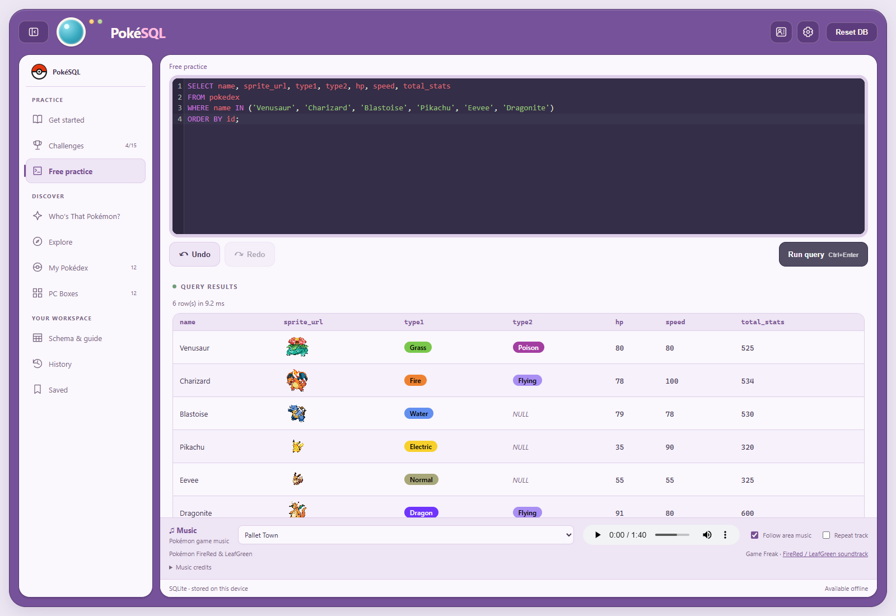

## Hoenn exploration

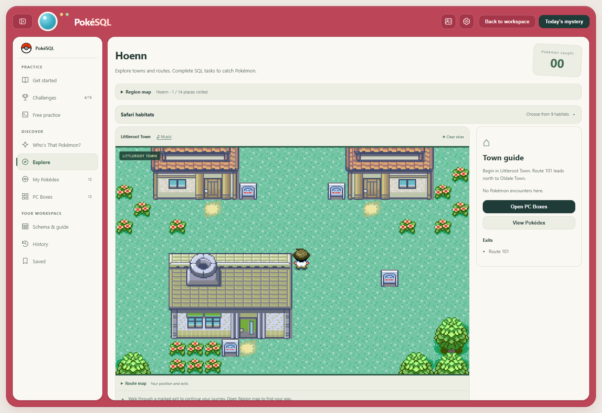

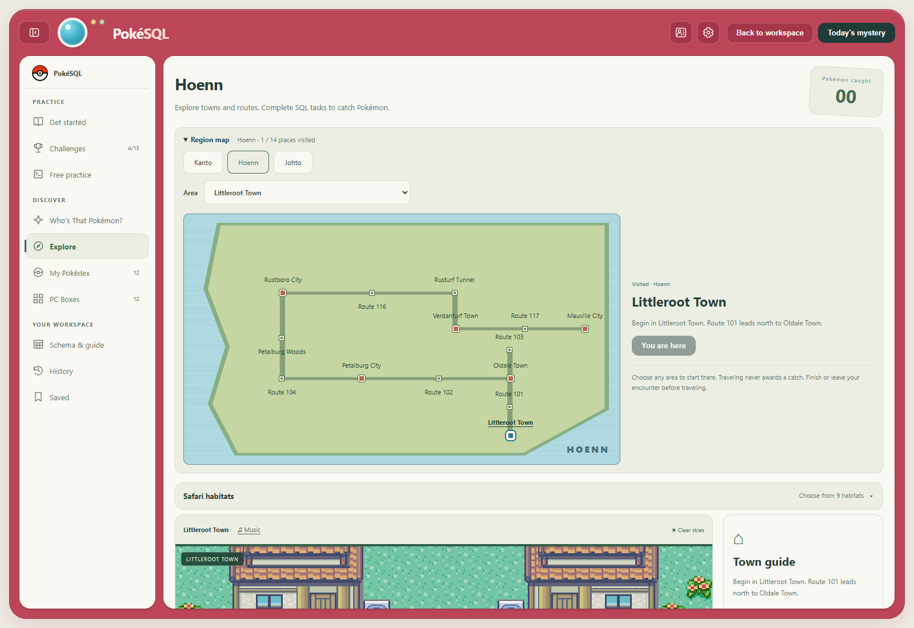

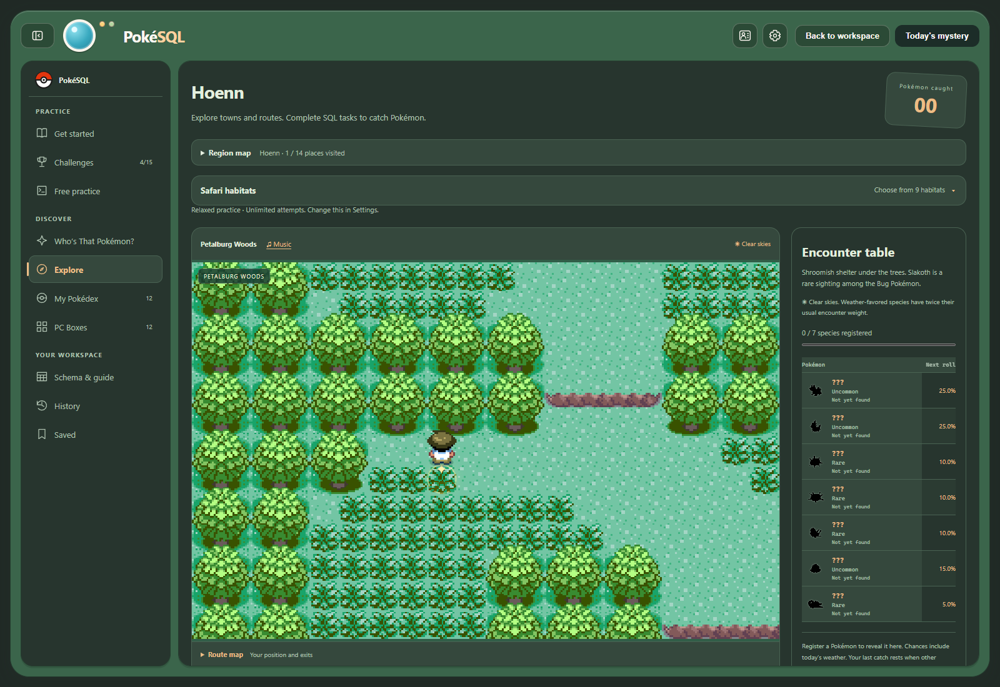

## Full-width Safari catch

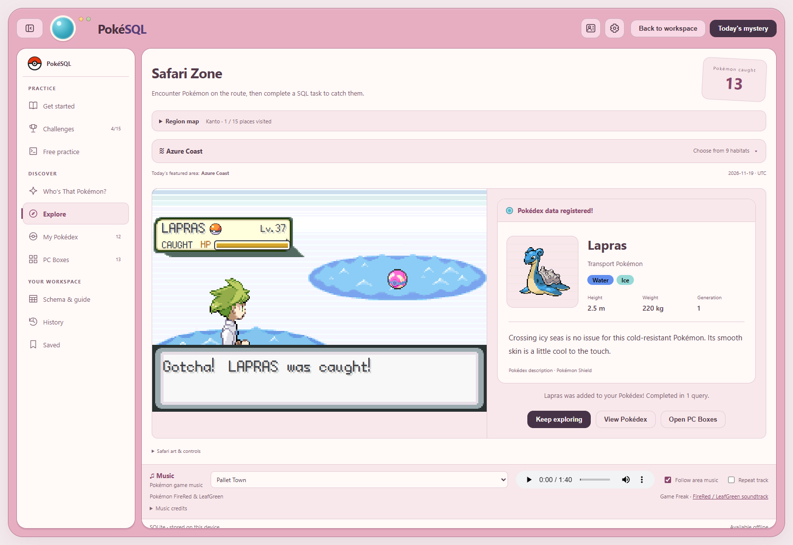

## Johto exploration

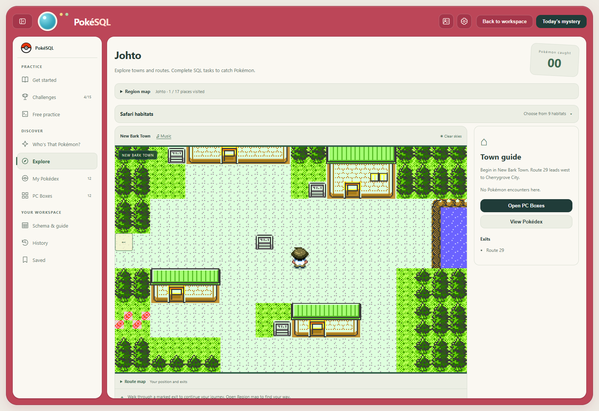

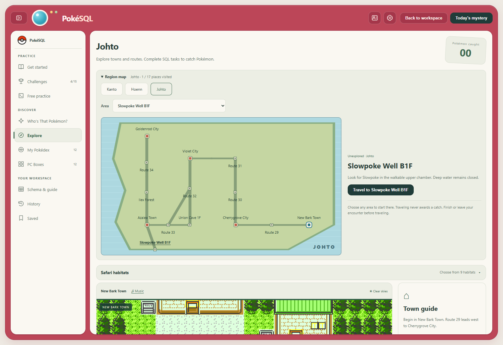

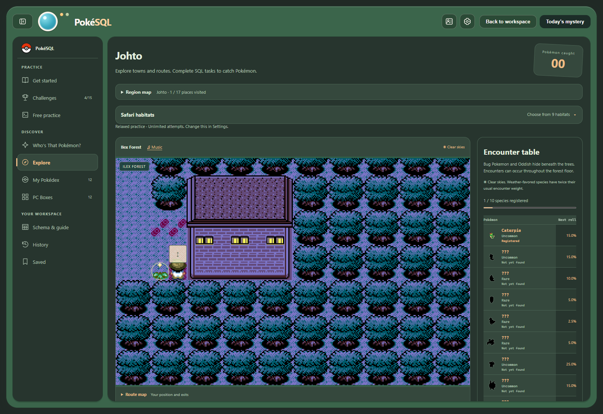

## Trainer ID

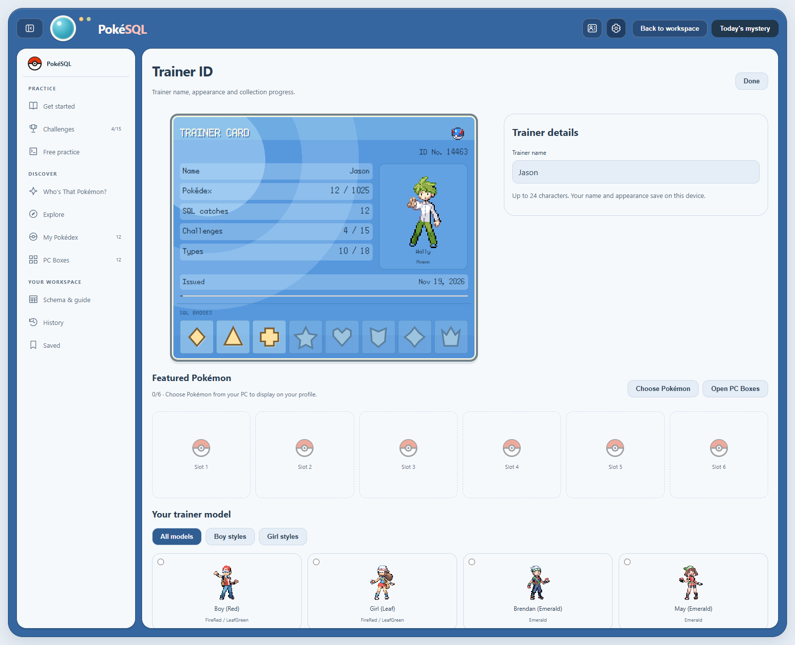

## Schema and guide

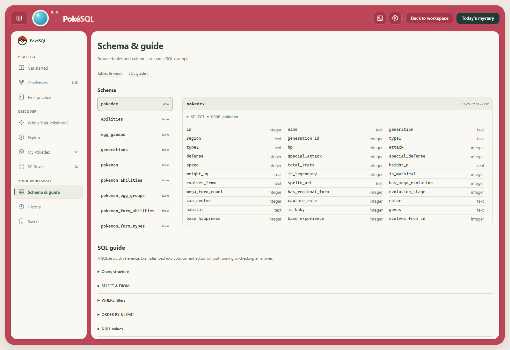

## PC Boxes and featured Pokémon

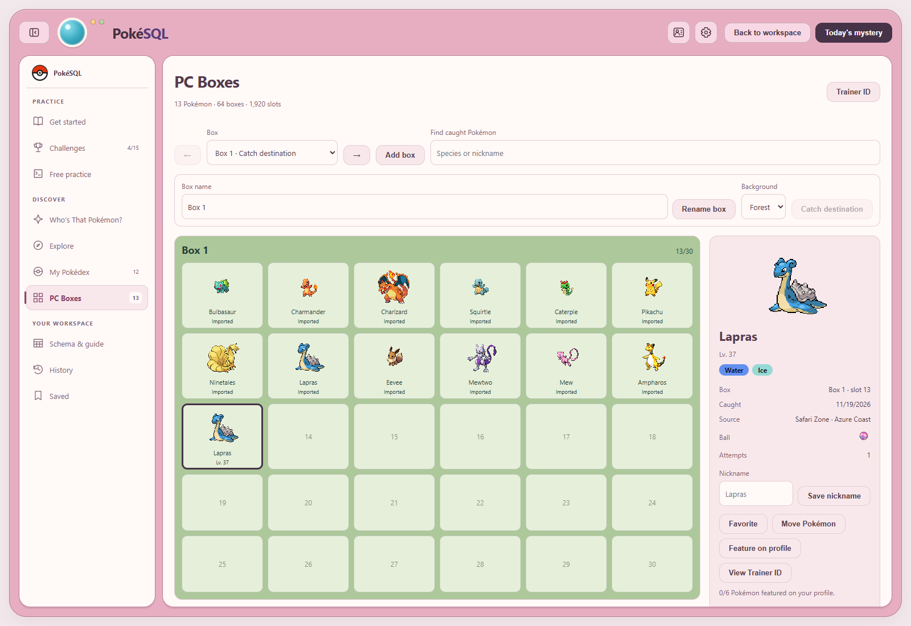

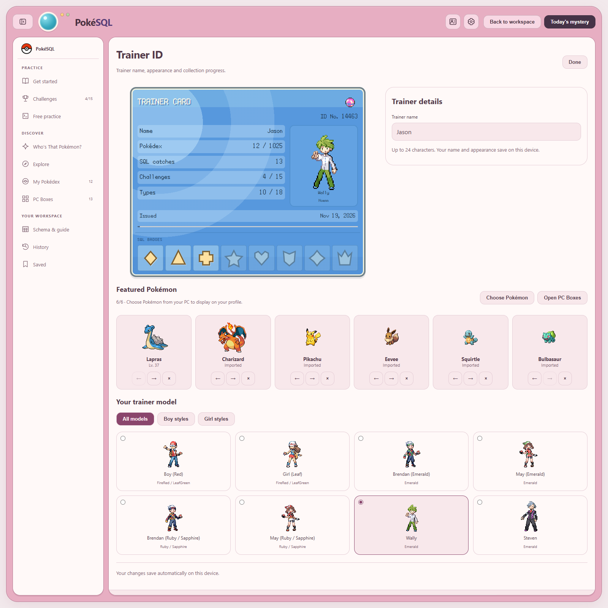

## Refresh these photos

From `web/`, run `npm.cmd run screenshots`. It builds production assets and uses
the separate Playwright screenshot project on its own strict port, 4176. The
normal test suite excludes this project. Captures wait for fonts, sprites and
offline assets, reset page scrolling, and save these same 38 filenames.
The Wailord mystery photos use a seeded random round. Its throw frame pauses
the actual pitch/ball animations briefly for capture, then resumes them; the
settled photo shows the successful catch. It does not reveal a daily answer.

Set `POKESQL_SCREENSHOT_DIR` to stage captures elsewhere before replacing the
gallery. Test results and failure traces stay in `web/test-results/`.
