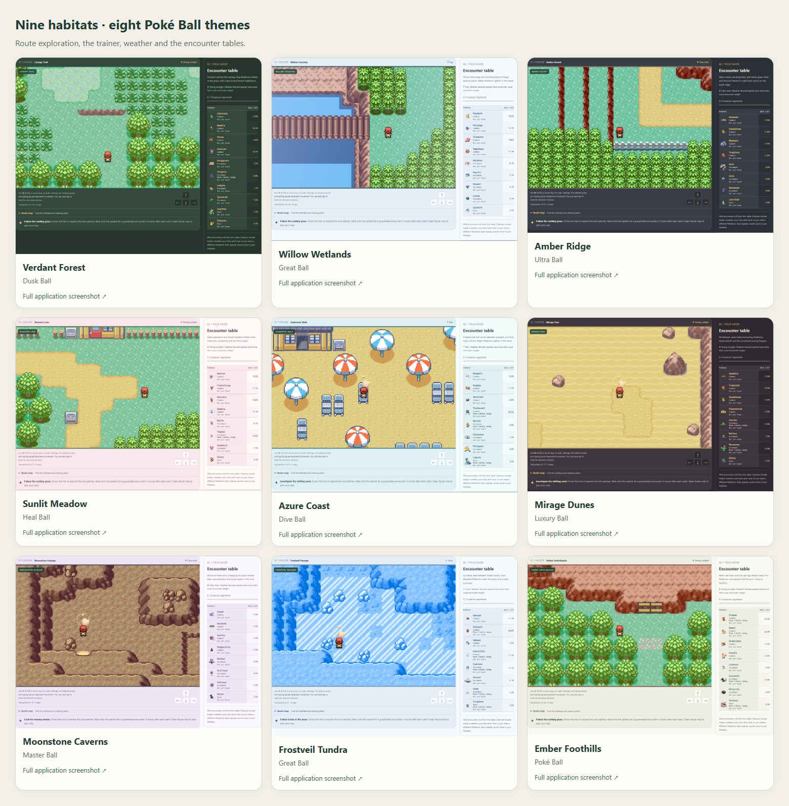
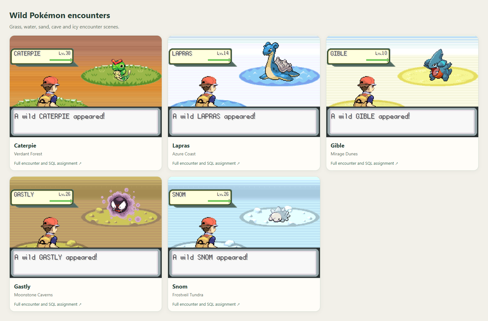
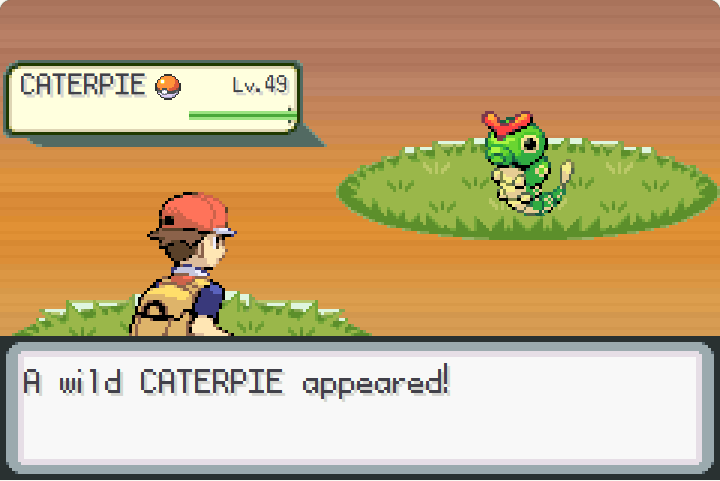

# Safari screenshots

Captured November 18, 2026, from the production application using isolated demo
profiles. This gallery contains 41 PNG images covering all nine habitats, all
eight Poké Ball themes, encounters, SQL catching, Pokédex registration, and mobile.

[Open the browser gallery](index.html) to browse the images at full resolution.

## Overviews

## Habitats and themes

| Habitat | Theme | Application screenshot | Route and encounter table |
| --- | --- | --- | --- |
| Verdant Forest | Dusk Ball | [View](forest-dusk-ball.png) | [View](forest-detail.png) |
| Willow Wetlands | Great Ball | [View](wetlands-great-ball.png) | [View](wetlands-detail.png) |
| Amber Ridge | Ultra Ball | [View](ridge-ultra-ball.png) | [View](ridge-detail.png) |
| Sunlit Meadow | Heal Ball | [View](meadow-heal-ball.png) | [View](meadow-detail.png) |
| Azure Coast | Dive Ball | [View](coast-dive-ball.png) | [View](coast-detail.png) |
| Mirage Dunes | Luxury Ball | [View](desert-luxury-ball.png) | [View](desert-detail.png) |
| Moonstone Caverns | Master Ball | [View](cave-master-ball.png) | [View](cave-detail.png) |
| Frostveil Tundra | Great Ball | [View](tundra-great-ball.png) | [View](tundra-detail.png) |
| Ember Foothills | Poké Ball | [View](volcano-poke-ball.png) | [View](volcano-detail.png) |

## Encounters

| Pokémon | Habitat | Battle screen | Encounter and SQL assignment |
| --- | --- | --- | --- |
| Caterpie | Verdant Forest | [View](caterpie-battle.png) | [View](caterpie-sql-encounter-dusk-ball.png) |
| Lapras | Azure Coast | [View](lapras-battle.png) | [View](lapras-sql-encounter-dive-ball.png) |
| Gible | Mirage Dunes | [View](gible-battle.png) | [View](gible-sql-encounter-luxury-ball.png) |
| Gastly | Moonstone Caverns | [View](gastly-battle.png) | [View](gastly-sql-encounter-master-ball.png) |
| Snom | Frostveil Tundra | [View](snom-battle.png) | [View](snom-sql-encounter-great-ball.png) |

## Catching and Pokédex registration

- [Successful Lapras catch in the Dive Ball theme](lapras-caught-dive-ball.png)
- [Catch result and automatic Pokédex entry](lapras-caught-detail.png)
- [Lapras Pokédex entry with species information](lapras-pokedex-entry.png)
- [Lapras in the personal Pokédex](lapras-pokedex-dive-ball.png)
- [Poké Ball marker beside an already registered Caterpie](registered-caterpie.png)

## Legendary and Mythical events

These examples use January 2, 2026, to demonstrate overlapping event windows.

- [Legendary and Mythical visitors with UTC dates and encounter odds](special-events-desktop.png)
- [Event information and habitat navigation on a small phone](special-events-mobile.png)
- [Celebi registered after a successful event catch](celebi-event-catch.png)

## Controls, settings, and mobile

- [All nine habitats in the area picker](all-habitats-picker.png)
- [Eight Poké Ball color themes in settings](pokeball-theme-settings.png)
- [Azure Coast on a 390px phone viewport](coast-mobile.png)

Rare encounter examples use species from the corresponding habitat tables.
The Lapras catch completed through its SQL assignment. Artwork and data sources
are listed in the [Safari credits](../../../web/public/safari/CREDITS.txt).
